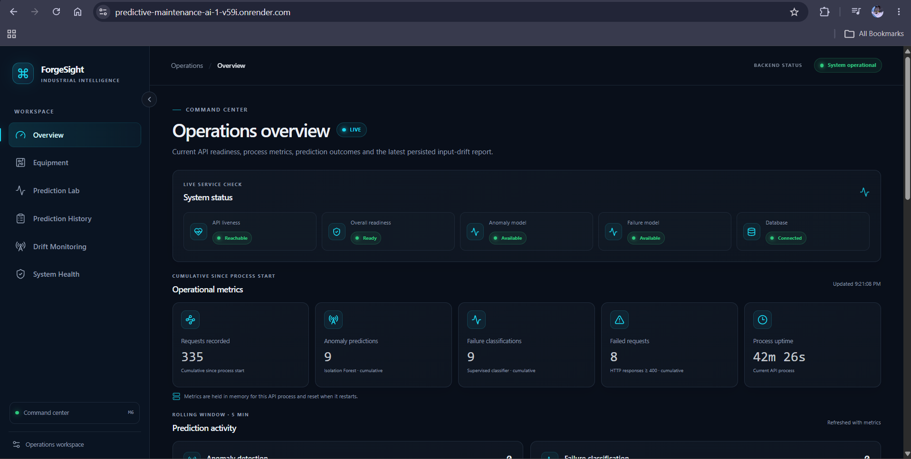
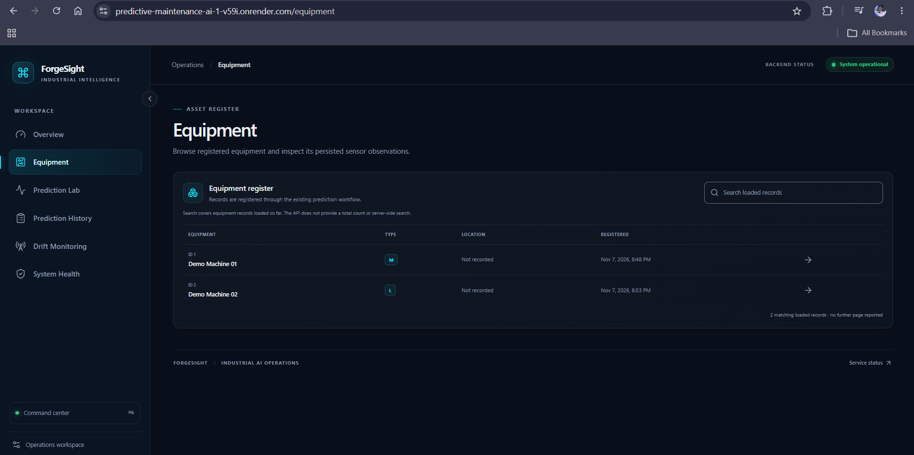
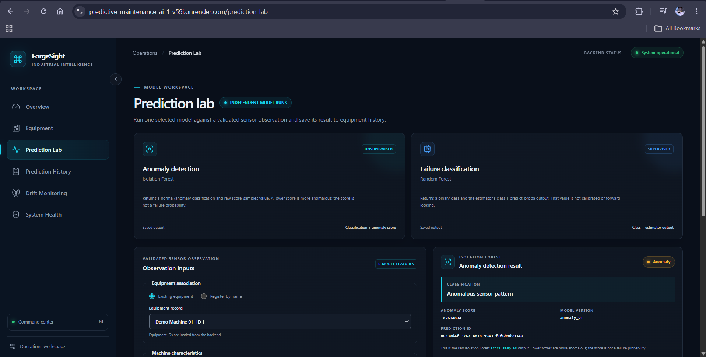
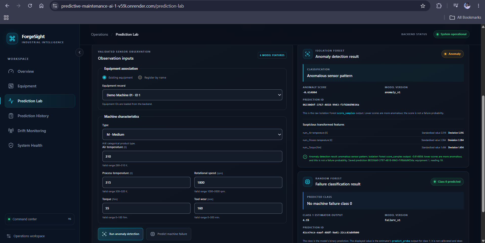
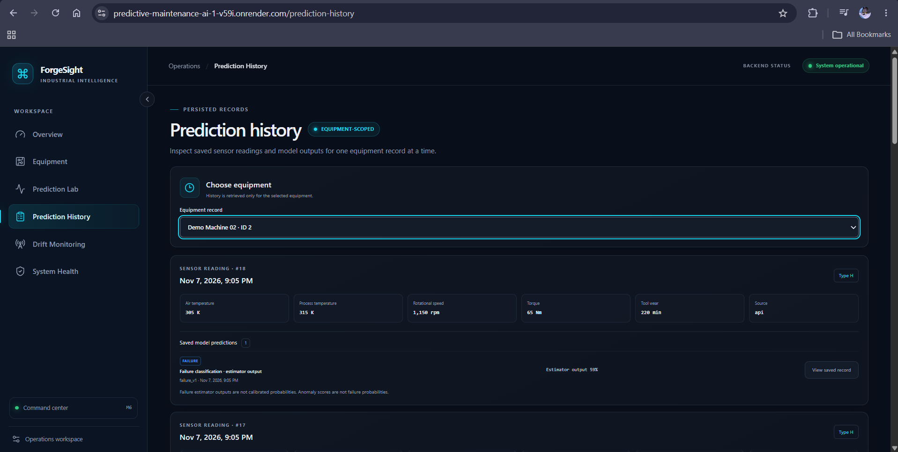
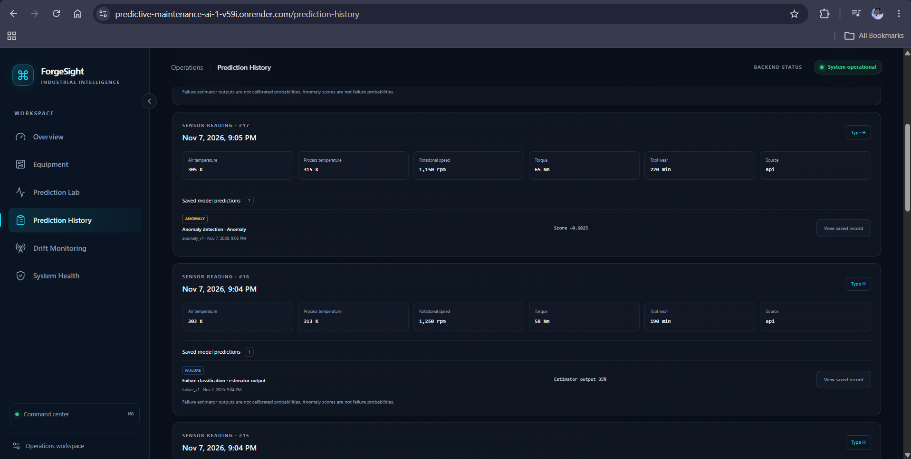
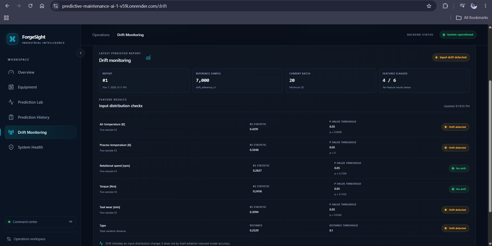
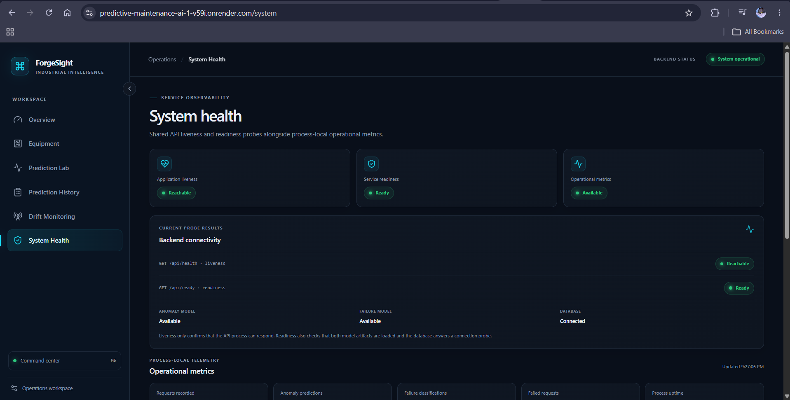
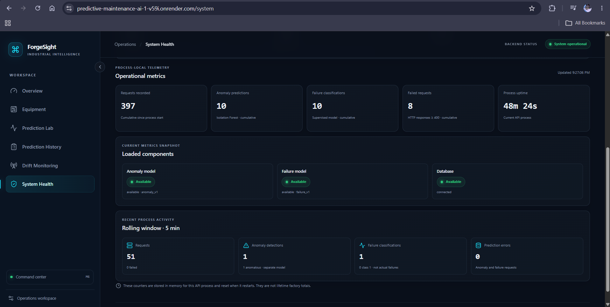

# ForgeSight

### Industrial Predictive Maintenance & Anomaly Detection Platform

ForgeSight is a full-stack machine-learning application for exploring sensor observations from industrial equipment. It pairs **unsupervised anomaly detection** with **supervised machine-failure classification**, persists prediction records, and presents equipment history and operational monitoring in a React dashboard.

  <a href="https://predictive-maintenance-ai-1-v59i.onrender.com"><strong>Live Demo</strong></a>
  ·
  <a href="https://predictive-maintenance-ai-7cfh.onrender.com/docs"><strong>API Documentation</strong></a>
  ·
  <a href="https://github.com/bhupinder-14/predictive-maintenance-ai"><strong>GitHub Repository</strong></a>

  
  
  
  

## Contents

- [Overview](#overview)
- [Live demo](#live-demo)
- [Screenshots](#screenshots)
- [Features](#features)
- [Architecture](#architecture)
- [Machine-learning methodology](#machine-learning-methodology)
- [Model performance](#model-performance)
- [Dataset](#dataset)
- [Technology stack](#technology-stack)
- [API](#api)
- [Local setup](#local-setup)
- [Testing](#testing)
- [Deployment](#deployment)
- [Limitations and future work](#limitations-and-future-work)
- [About](#about)

## Overview

Industrial equipment produces sensor readings that can reveal unusual operating patterns or match conditions associated with recorded failures. ForgeSight demonstrates two distinct analyses of an observation:

- **Anomaly detection:** an Isolation Forest identifies observations that differ from the learned operating distribution.
- **Failure classification:** a Random Forest classifies whether an observation matches the dataset's machine-failure label.

A FastAPI service loads the saved model artifacts, validates requests, runs inference, and stores readings and results through SQLAlchemy and SQLite. A React and TypeScript dashboard presents equipment, prediction workflows, history, drift reports, and service health.

The project is built and evaluated with the **UCI AI4I 2020 Predictive Maintenance Dataset**. It does not ingest live industrial telemetry, model time sequences, forecast a future failure window, or estimate remaining useful life (RUL).

## Live demo

- **Frontend:** [predictive-maintenance-ai-1-v59i.onrender.com](https://predictive-maintenance-ai-1-v59i.onrender.com)
- **FastAPI Swagger UI:** [predictive-maintenance-ai-7cfh.onrender.com/docs](https://predictive-maintenance-ai-7cfh.onrender.com/docs)

The services run on Render Free and can take time to respond after an idle period. SQLite data is stored on the free instance's ephemeral filesystem; saved history and drift reports may be lost after restarts, redeployments, or instance replacement.

## Screenshots

### Application Preview

These captures show the deployed ForgeSight interface with persisted application records. Live counters and statuses reflect the backend at capture time. See the [screenshot capture procedure](docs/screenshots/README.md) for context and interpretation limits.

### Operations Overview

*The overview brings together service readiness, cumulative process metrics, and prediction activity in the operations workspace.*

### Equipment Management

*The equipment register lists persisted equipment metadata and provides search over the records currently loaded by the frontend.*

### Prediction Lab

*The lab presents separate anomaly and failure workflows alongside the sensor form; the visible anomaly score is the raw Isolation Forest score, not a failure probability.*

*The result view shows the submitted sensor values, anomaly classification and score, and the failure classifier's uncalibrated estimator output.*

### Prediction History

*History is selected by equipment and displays persisted readings with their associated saved model predictions.*

*This view continues the equipment-scoped record list, showing saved anomaly scores and failure-estimator outputs across readings with the calibration caveat visible.*

### Drift Monitoring

*The latest persisted report compares a 20-observation batch with the training reference using feature-level KS and total variation distance checks. Drift flags indicate input distribution differences, not reduced model accuracy.*

### System Health

*The health view separates process liveness from readiness checks for both models and the database.*

*Operational metrics include process-lifetime counters and a rolling window; these values are held in memory and reset when the API process restarts.*

## Features

The frontend has seven client-side routes:

| Route | What it provides |
| --- | --- |
| **Overview** <code>/</code> | API readiness, process-local operational metrics, prediction-family counts, and the latest saved drift report. The activity panel states that no global prediction feed exists. |
| **Equipment Explorer** <code>/equipment</code> | Browse registered equipment and open an equipment profile. |
| **Equipment Profile** <code>/equipment/:equipmentId</code> | Inspect equipment-scoped persisted readings, model results, and history-derived trends. |
| **Prediction Lab** <code>/prediction-lab</code> | Submit a validated observation to either the anomaly model or failure classifier as separate prediction requests. |
| **Prediction History** <code>/prediction-history</code> | Browse paginated history for a selected equipment item and retrieve an individual saved prediction. |
| **Drift Monitoring** <code>/drift</code> | View the latest persisted drift report, or an empty state when no report has been saved. |
| **System Health** <code>/system</code> | Review API liveness, dependency readiness, and process-local metrics. |

The API can associate an observation with existing equipment or register new equipment from the supplied equipment name and location. Prediction requests persist the observation and its result. Drift evaluation is a separate operation: it evaluates a validated batch against the saved reference and persists the resulting report; the dashboard does not generate a report automatically.

The UI includes request validation feedback and loading, error, and empty states. History is equipment-scoped, metrics are process-local, and the API has no authentication or authorization.

## Architecture

~~~mermaid
flowchart LR
  FE["React + TypeScript Render Static Site"] --> AX["Axios API client"]
  AX -->|"HTTPS REST"| API["FastAPI Render Docker Web Service"]

  API --> INFER["Inference services"]
  ART["Six versioned model artifacts"] -->|"loaded at API startup"| REG["Model registry"]
  REG --> INFER
  INFER --> IF["Isolation Forest"]
  INFER --> RF["Random Forest"]
  INFER --> ORM["SQLAlchemy persistence"]
  ORM --> DB[("SQLite")]
  REF["Saved drift reference"] --> MON["Drift monitoring"]
  API --> MON
  MON --> ORM
~~~

The frontend is deployed as a Render Static Site, separately from the FastAPI Docker Web Service. In local development, Vite serves the frontend and proxies API requests. Root Docker Compose starts the backend API only; it does not run the React frontend.

## Machine-learning methodology

### Anomaly detection

The unsupervised pipeline uses **Isolation Forest** with a configured contamination of **0.05**. The API returns a normal/anomaly classification and the estimator's raw <code>score_samples</code> value. Lower scores indicate observations that are more anomalous relative to the fitted data.

An anomaly score is **not** a failure probability. An unusual observation is not necessarily a failure, and a failure-classifier output is a separate model result.

### Failure classification

The supervised pipeline compares Logistic Regression and Random Forest candidates. A stratified validation set supports model and threshold selection; the selected Random Forest is evaluated once on a held-out test set. The estimator's <code>predict_proba</code> output is uncalibrated and should not be interpreted as a calibrated failure probability.

Preprocessing is fitted on training rows only and then reused for validation, test, and inference. The six model inputs are:

- <code>Type</code>
- Air temperature [K]
- Process temperature [K]
- Rotational speed [rpm]
- Torque [Nm]
- Tool wear [min]

<code>UDI</code>, <code>Product ID</code>, the target <code>Machine failure</code>, and failure-mode labels <code>TWF</code>, <code>HDF</code>, <code>PWF</code>, <code>OSF</code>, and <code>RNF</code> are excluded from model inputs. The latter labels encode failure outcomes and would leak target information.

The dataset is split stratified by target into **7,000 training**, **1,000 validation**, and **2,000 test** rows, using seed 42. The validation data is used for model/threshold selection; the held-out test data is reserved for final reported metrics.

## Model performance

The selected Random Forest's reported held-out test results are:

| Metric | Test result |
| --- | ---: |
| Precision | 0.7955 |
| Recall | 0.5147 |
| F1 score | 0.6250 |
| PR-AUC | 0.7406 |
| ROC-AUC | 0.9648 |
| Accuracy | 0.9790 |

Confusion matrix at the selected threshold:

|  | Predicted no failure | Predicted failure |
| --- | ---: | ---: |
| Actual no failure | TN: 1,923 | FP: 9 |
| Actual failure | FN: 33 | TP: 35 |

There are 339 positive failure labels among 10,000 rows, so the target is imbalanced. Accuracy alone would hide the cost of missed failures; precision, recall, and PR-AUC provide important context. These figures are **offline held-out dataset metrics**, not estimates of live or production performance.

On its held-out test partition, the Isolation Forest flagged **103 of 2,000 rows** as anomalous (5.15%). This is an anomaly-detection count, not a failure-prediction metric.

## Dataset

ForgeSight uses the [UCI AI4I 2020 Predictive Maintenance Dataset](https://archive.ics.uci.edu/dataset/601/ai4i+2020+predictive+maintenance+dataset), a 10,000-row, 14-column tabular dataset with 339 machine-failure labels. The model target is <code>Machine failure</code>; model inputs are the six sensor/type features listed above.

The raw CSV is not included in the repository. To reproduce training or regenerate the drift reference, obtain the official dataset and place its CSV at:

~~~text
data/raw/ai4i2020.csv
~~~

The ingestion code reads this path and handles the dataset's UTF-8 BOM. The tracked model and reference artifacts are sufficient for ordinary API inference without the raw training CSV or retraining.

This dataset contains tabular observations, not a continuous sequence of telemetry per machine. It does not support claims of live equipment deployment, future-failure forecasting, or RUL estimation.

## Technology stack

| Area | Technologies |
| --- | --- |
| Backend and ML | Python, FastAPI, Pydantic, Pandas, NumPy, scikit-learn, SQLAlchemy, SQLite, joblib |
| Frontend | React, TypeScript, Vite, Tailwind CSS, React Router, Axios, TanStack Query, Recharts, Lucide |
| Packaging and tests | Docker, Docker Compose, Pytest, Vitest, React Testing Library, Playwright, GitHub Actions |

## API

The complete interactive schema is available in the [live Swagger documentation](https://predictive-maintenance-ai-7cfh.onrender.com/docs).

| Method | Path | Purpose |
| --- | --- | --- |
| <code>GET</code> | <code>/health</code> | Process liveness. |
| <code>GET</code> | <code>/ready</code> | Readiness of both model bundles and the database. |
| <code>POST</code> | <code>/predict/anomaly</code> | Run and persist an anomaly prediction. |
| <code>POST</code> | <code>/predict/failure</code> | Run and persist a failure classification. |
| <code>GET</code> | <code>/equipment</code> | List registered equipment. |
| <code>GET</code> | <code>/equipment/{equipment_id}/history</code> | Retrieve paginated history for one equipment item. |
| <code>GET</code> | <code>/predictions/{prediction_id}</code> | Retrieve a saved prediction. |
| <code>GET</code> | <code>/monitoring/metrics</code> | Read operational counters and a readiness snapshot. |
| <code>GET</code> | <code>/metrics/summary</code> | Alias for the operational metrics summary. |
| <code>POST</code> | <code>/monitoring/drift</code> | Evaluate a validated batch against the saved reference and persist a report. |
| <code>GET</code> | <code>/monitoring/drift</code> | Retrieve the latest persisted drift report; returns not found when none exists. |

## Local setup

Clone the repository and use Python 3.12 or newer plus Node.js 22.12.0 or newer:

~~~powershell
git clone https://github.com/bhupinder-14/predictive-maintenance-ai.git
cd predictive-maintenance-ai
~~~

### Run the API directly

From the repository root, create and activate a Python environment, then install the development requirements:

~~~powershell
py -3.12 -m venv .venv
.\.venv\Scripts\Activate.ps1
python -m pip install --upgrade pip
python -m pip install -r requirements-dev.txt
python -m uvicorn src.api.main:app --host 127.0.0.1 --port 8000
~~~

On macOS or Linux, activate with <code>source .venv/bin/activate</code> instead. The API loads the six tracked model artifacts and drift reference at startup. The local SQLite database defaults to <code>predictive_maintenance.db</code> in the project root. Open [http://127.0.0.1:8000/docs](http://127.0.0.1:8000/docs) for Swagger UI.

### Run the frontend

In a second terminal:

~~~powershell
cd frontend
npm ci
npm run dev
~~~

Vite serves the app at <code>http://127.0.0.1:5173</code>. By default, the browser uses the same-origin <code>/api</code> base and Vite strips that prefix before proxying to <code>http://127.0.0.1:8000</code>. To proxy to a different backend during development, set <code>API_PROXY_TARGET</code> for the Vite process. For direct cross-origin browser requests, configure the frontend build variable <code>VITE_API_BASE_URL</code> to the backend origin and set backend <code>FRONTEND_ORIGIN</code> to the exact frontend origin; CORS is disabled when <code>FRONTEND_ORIGIN</code> is unset.

### Run the backend with Docker Compose

From the repository root:

~~~powershell
docker compose up --build
~~~

Compose starts the backend API only, publishes it on <code>127.0.0.1:8000</code> by default, and stores SQLite data in its named volume. It does not start the React frontend. Stop the containers with <code>Ctrl+C</code> in the attached terminal, or run <code>docker compose down</code> in another terminal; <code>down</code> retains the named volume.

### Optional: reproduce model training

Training is separate from inference and requires the official CSV at <code>data/raw/ai4i2020.csv</code>. The scripts below are present in the repository:

~~~powershell
python -m scripts.train_anomaly
python -m scripts.train_failure
python -m scripts.evaluate
~~~

Training scripts write model artifacts and evaluation outputs under <code>models/</code>; do not run them in a checkout where you need to preserve the tracked artifacts. The API itself does not train or regenerate models.

## Testing

From the repository root, run the backend suite:

~~~powershell
python -m pytest -q
~~~

From <code>frontend/</code>, install locked dependencies and run the frontend checks:

~~~powershell
npm ci
npm run typecheck
npm test -- --configLoader runner --reporter=dot
npm run build -- --configLoader runner
npm ls --depth=0
~~~

The Playwright browser suite can be run after installing its Chromium browser:

~~~powershell
npx playwright install chromium
npm run test:e2e
~~~

The end-to-end suite intercepts API calls with controlled fixtures. It tests frontend behavior and navigation; it does not validate the live backend, persistence, or deployment integration. The GitHub Actions workflow runs frontend typecheck, unit tests, build, dependency validation, and the mocked API browser suite. This README does not claim that any particular CI run passed.

## Deployment

The deployed architecture uses two Render services:

| Service | Render configuration |
| --- | --- |
| Backend | Web Service, Docker runtime, repository root, <code>Dockerfile</code>, health check path <code>/ready</code>. The container binds to <code>0.0.0.0</code> and selects <code>PORT</code>, then <code>APP_PORT</code>, then <code>8000</code>. |
| Frontend | Static Site, root directory <code>frontend</code>, build command <code>npm ci && npm run build</code>, publish directory <code>dist</code>. Configure a rewrite from <code>/*</code> to <code>/index.html</code> so direct route navigation and refresh work with React Router. |

Configure the frontend build-time <code>VITE_API_BASE_URL</code> to the backend origin (no <code>/api</code> suffix). Configure backend <code>FRONTEND_ORIGIN</code> to the exact deployed frontend origin, with scheme and host only. For the currently linked deployment, these values are:

~~~text
VITE_API_BASE_URL=https://predictive-maintenance-ai-7cfh.onrender.com
FRONTEND_ORIGIN=https://predictive-maintenance-ai-1-v59i.onrender.com
~~~

Render provides the <code>PORT</code> environment variable for the backend service. <code>VITE_API_BASE_URL</code> is public browser configuration, not a secret. CORS permits only the configured origin, the required GET/POST methods, and Accept/Content-Type headers; it is not authentication or access control.

The free service can cold-start after idle periods. Its SQLite filesystem is ephemeral, so saved prediction history and drift reports are not durable and may disappear after restarts or redeployments.

## Limitations and future work

**Current limitations**

- AI4I is tabular data, not continuous time-series telemetry.
- The classifier labels an observation; it does not forecast future failure or estimate RUL.
- There is no authentication or authorization.
- Operational metrics are process-local and reset when the API restarts.
- Render Free SQLite storage is ephemeral; the application makes no durable-storage guarantee.
- No industrial sensor integration or live ingestion is implemented.
- Drift monitoring compares input distributions; it does not establish model accuracy degradation.

**Potential future work (not implemented)**

- PostgreSQL or another durable database for hosted history.
- Authentication and role-based authorization.
- Industrial telemetry ingestion with suitable security and validation.
- Time-series modeling and RUL estimation using appropriate longitudinal datasets.
- Durable monitoring, alerting, and operational SLOs.

## About

ForgeSight is an engineering portfolio project by Bhupinder, combining leakage-aware model evaluation with a typed API, persistence, monitoring, and a responsive operations interface.

[Explore the source on GitHub](https://github.com/bhupinder-14/predictive-maintenance-ai).
