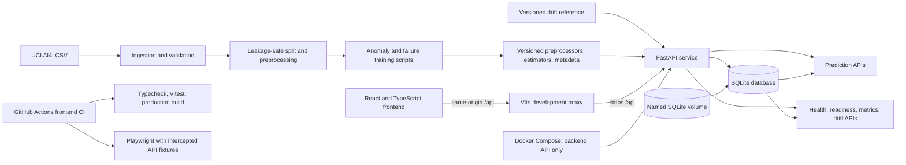
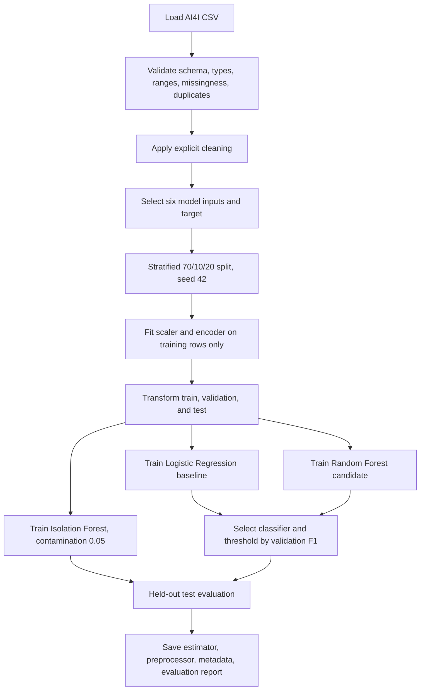
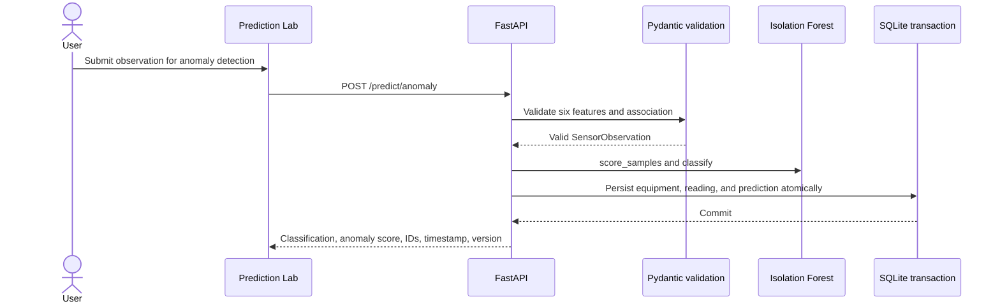
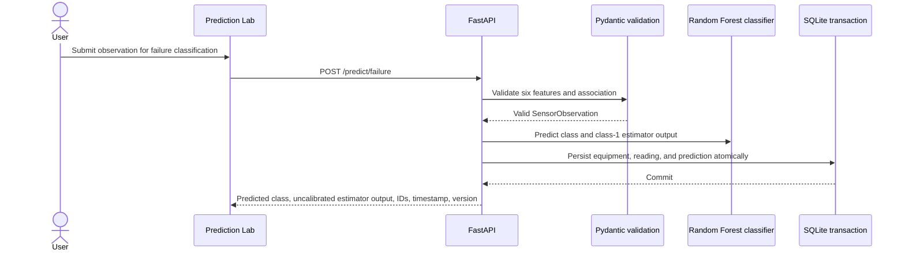
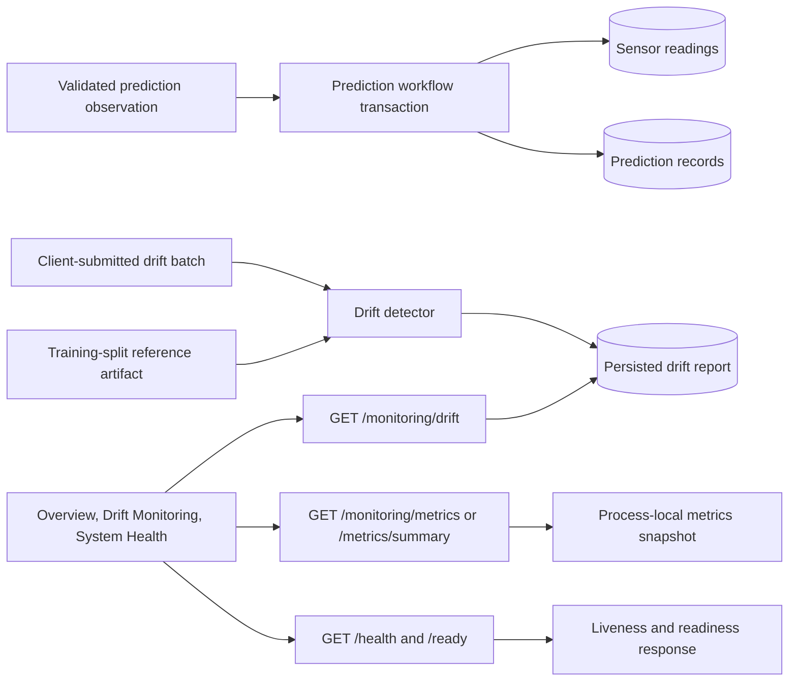
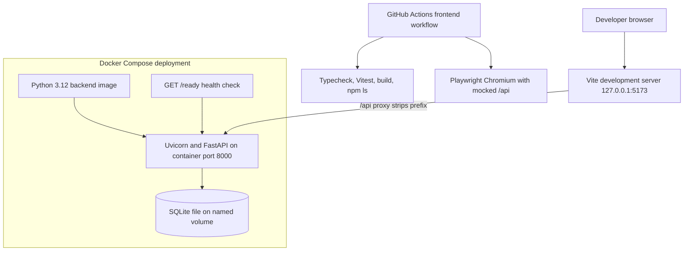

# Architecture

This document describes the current repository implementation. The backend and frontend are independently started in local development. Docker Compose deploys only the FastAPI backend; GitHub Actions runs frontend checks and mocked Playwright tests.

## High-level architecture

The offline training pipeline produces the inference artifacts consumed at API startup. The frontend uses Axios and TanStack Query to request actual API data. The Vite proxy is a development arrangement; it is not a deployed reverse proxy. CI's browser tests intercept requests and are not live backend integration tests.

## ML training pipeline

`UDI`, `Product ID`, and the five failure-mode labels are not model features. Fitted preprocessing does not see validation or test data. The Random Forest selection and threshold use validation F1; the held-out test results are reported separately. Isolation Forest is evaluated as anomaly detection, including overlap with failure labels only as descriptive comparison—not as equivalence between anomaly and failure.

## Prediction request flows

The frontend presents two independent model actions. Both use the same six validated sensor inputs, but each request executes only its selected model.

Anomaly scores are Isolation Forest `score_samples` values, not failure probabilities. The supervised class-1 output is not separately calibrated and is not a future forecast. The frontend does not automatically retry prediction POST requests; after a timeout it warns that the outcome may be unknown and directs the user to equipment-scoped history.

## Monitoring and drift flow

Drift is evaluated on a submitted batch, not on a continuous sensor stream. Numeric features use two-sample KS tests; categorical `Type` uses total variation distance. The minimum current batch size is configurable (default 20); defaults are KS alpha 0.05 and TVD threshold 0.10. A successful report is saved, and GET returns the latest report only (404 if none exists). Drift does not establish model degradation. Metrics are in-memory and process-local; they reset on restart and are not shared across worker processes. `/health` is liveness; `/ready` checks loaded model bundles and a database connectivity probe.

## Deployment and development topology

Compose publishes the backend API and persists its SQLite data in a named volume. The frontend is run separately with `npm run dev`; there is no frontend container, production static server, or full-stack Compose deployment in this repository. The `/ready` Compose health check requires both model bundles and a working database. The runtime image uses an unprivileged UID, a read-only root filesystem, a restricted temporary filesystem, dropped Linux capabilities, and `no-new-privileges`; these controls are not a security certification. No authentication or authorization is implemented.

The GitHub Actions workflow runs on pull requests and pushes to `master` plus manual dispatch. It installs frontend dependencies with `npm ci`, typechecks, runs Vitest, builds, checks `npm ls --depth=0`, installs Chromium, and runs Playwright tests. API calls in browser tests are intercepted with fixtures. CI does not verify backend connectivity, persistence, or deployment. See [Frontend setup and CI](../frontend/README.md).
